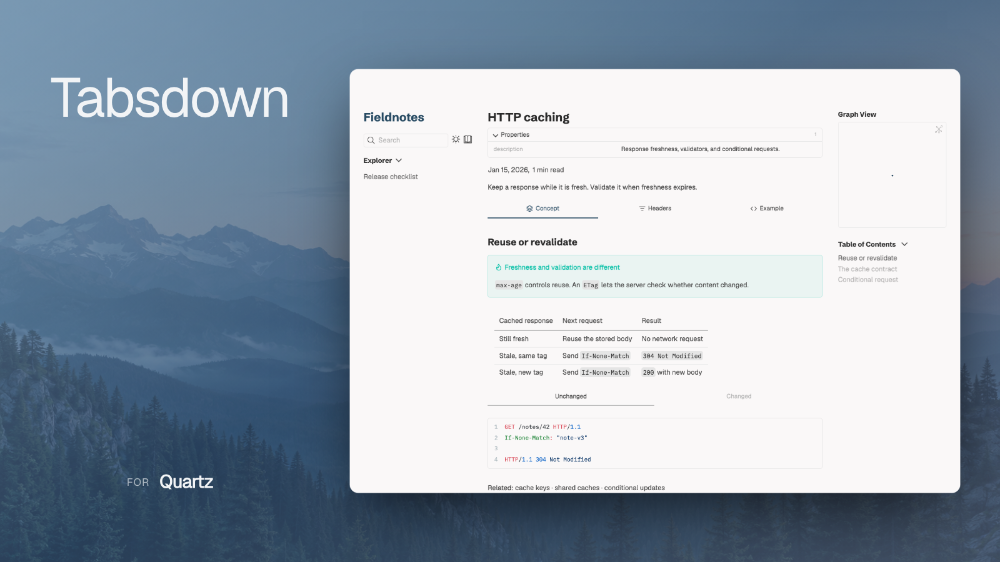

# quartz-tabsdown

quartz-tabsdown renders [Tabsdown](https://github.com/grafanaKibana/obsidian-tabsdown) Markdown as theme-native tabs in [Quartz](https://quartz.jzhao.xyz/). The same marker layouts and fenced blocks work in Obsidian and on the published site.

<picture>
  <source media="(prefers-color-scheme: dark)" srcset="docs/assets/product-captures/hero-dark.png">
  <source media="(prefers-color-scheme: light)" srcset="docs/assets/product-captures/hero.png">
  
</picture>

<p align="center">
<a href="https://github.com/grafanaKibana/quartz-tabsdown/blob/main/docs/configuration.md"><picture><source media="(prefers-color-scheme: dark)" srcset="https://shieldcn.dev/badge/Quartz-%E2%89%A55.svg?variant=outline&amp;size=sm&amp;font=geist&amp;mode=dark&amp;logo=ri%3ALuGem&amp;color=a079ff&amp;logoColor=a079ff&amp;valueColor=fafafa&amp;labelTextColor=fafafa"></picture></a>
<a href="https://github.com/grafanaKibana/quartz-tabsdown/releases/latest"><picture><source media="(prefers-color-scheme: dark)" srcset="https://shieldcn.dev/github/release/grafanaKibana/quartz-tabsdown/stable.svg?variant=outline&amp;size=sm&amp;font=geist&amp;mode=dark&amp;label=Version"></picture></a>
<a href="https://github.com/grafanaKibana/quartz-tabsdown/actions/workflows/ci.yml"><picture><source media="(prefers-color-scheme: dark)" srcset="https://shieldcn.dev/github/ci/grafanaKibana/quartz-tabsdown.svg?variant=outline&amp;size=sm&amp;font=geist&amp;mode=dark&amp;label=CI&amp;workflow=ci.yml&amp;branch=main&amp;statusDot=true"></picture></a>
</p>

## What it does

- Renders Markdown, links, embeds, callouts, math, and syntax highlighting inside tabs.
- Supports nested tabs, formatted labels, Lucide icons, and tab lists on any side.
- Matches Quartz light and dark themes, with theme-following or custom tab corner radii.
- Keeps every panel readable when JavaScript is unavailable.
- Exposes an optional browser API for custom Quartz components.

## Install

```bash
npx quartz plugin add github:grafanaKibana/quartz-tabsdown
```

Enable the plugin in `quartz.config.yaml`:

```yaml
plugins:
  - source: github:grafanaKibana/quartz-tabsdown
    enabled: true
```

See [plugin configuration](docs/configuration.md) for `quartz.ts`, transformer order, and validation behavior.

## Syntax

Use comment markers for tabs whose bodies remain ordinary Markdown:

```markdown
%% tabs %%
%% config: position=left, layout=multi %%

%% tab: icon:book **First** %%

Normal Markdown content.

%% tab: Second %%

More content.

%% endtabs %%
```

Marker lines can be adjacent without blank lines. They also work inside lists and blockquotes, using the normal Markdown container prefixes. A layout needs at least two non-empty, unique labels, and optional configuration belongs before the first tab.

Existing fenced syntax remains supported. Inside a `tabsdown` fence, start each tab with a column-zero `tab: <label>` line and add optional column-zero `config: <values>` lines before the first tab:

`````markdown
````tabsdown
config: position=top, layout=multi

tab: **Python**

```python
print("Hello Tabsdown")
```

tab: `JavaScript`

```javascript
console.log("Hello Tabsdown");
```
````
`````

`position=top|left|right|bottom` places the tab list. `layout=one` keeps labels on one scrollable line, while `layout=multi` lets them wrap.

Blocks can also override appearance with `density=default|compact`, `personality=button|underline|separator|rail`, `palette=primary|secondary`, and `alignment=start|center|equal-width`. These settings override site-wide and position-specific styles for that block; nested and sibling blocks keep their own settings.

Every configuration value must use `key=value` syntax. Bare values such as `config: top, multi` are rejected; use `config: position=top, layout=multi` instead. Repeating a key, including across multiple config lines, is an error.

For fenced layouts, use matching backtick or tilde fences. The outer fence must be longer than any matching fence inside it. Empty tab bodies are valid.

### Labels and icons

Labels support `**bold**`, `*italic*`, `~~strikethrough~~`, and backtick inline code. Links, wikilinks, images, raw HTML, nested formatting, and malformed delimiters remain literal text.

Start a label with `icon:<name>` to use a bundled [Lucide](https://lucide.dev/icons/) icon:

````markdown
```tabsdown
tab: icon:code Python
tab: icon:file-text Notes
```
````

An unknown icon name renders no icon. Escape a literal icon prefix as `tab: \icon:name` (or `%% tab: \icon:name %%`) and a literal fenced tab line as `\tab:`.

### Nested tabs

A tab body can contain marker layouts, fenced layouts, or a mixture of both. Nested marker layouts need their own matching `%% endtabs %%`. When nesting fences, make the inner fence shorter than the outer fence. Each level keeps its own active tab and configuration.

Nested blocks default to the secondary palette, matching Obsidian. An explicit block `palette=` setting overrides that default.

### Literal content and diagnostics

Marker-like text inside frontmatter, code spans, code fences, indented code, raw HTML, and math does not open a layout. Controls inside ordinary Obsidian comments also do not open layouts; those comments follow Quartz's normal comment-removal behavior. Structural controls occupy their own lines; inline prose containing `%% tabs %%` does not open a layout.

Missing closing markers, invalid configuration, empty or duplicate labels, fewer than two tabs, and content before the first tab produce a diagnostic with the original source and location. Keep configuration before the first tab; later configuration lines belong to that tab's content.

## Without JavaScript

Quartz emits every panel in source order with its label. The client script adds tab behavior and hides inactive panels only after it loads, so the content stays readable when JavaScript is disabled or fails.

## Guides

- [Configure the Quartz plugin](docs/configuration.md)
- [Customize appearance](docs/style-options.md)
- [Mount panels from a custom Quartz component](docs/mounting-panels.md)
- [Develop and verify quartz-tabsdown](docs/development.md)

## Troubleshooting

- **A wikilink or callout renders incorrectly:** Keep Tabsdown before Obsidian Flavored Markdown. The default order is already correct.
- **A block shows a diagnostic:** Check matching marker delimiters (or column-zero `tab:` lines inside fences), unique labels, and at least two tabs.
- **An inner fence closes Tabsdown:** Make the outer fence longer than every matching fence inside it, or use tildes.
- **The build rejects style options:** The error includes the invalid configuration path. Compare it with the [style schema](docs/style-options.md).
- **Still stuck:** [Open an issue](https://github.com/grafanaKibana/quartz-tabsdown/issues) with the block, configuration, and Quartz version.

## Development

See [development and verification](docs/development.md).

## License

[MIT](LICENSE)

[Regenerate product images](https://github.com/grafanaKibana/product-captures#configuration)
